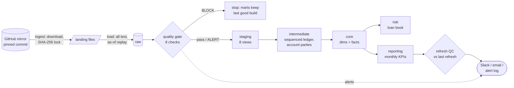

# Bank data platform

An end-to-end analytics engineering pipeline on real retail-banking data: checksum-verified ingestion, a dbt star schema on DuckDB (Snowflake-ready), a blocking quality gate, refresh-over-refresh QC, alerting, and the same pipeline orchestrated two ways, in Airflow and in Dagster.

The data is the PKDD'99 Czech bank dataset: 4,500 accounts, 5,369 clients, 682 loans and 1,056,320 transactions from 1993 to 1998. It's one of the few public datasets with a real bank ledger, and it is messy in the ways real banking data is.

| | |
|---|---|
| **Stack** | Python 3.12, dbt Core 1.12, DuckDB, Airflow 3.4 (Docker), Dagster 1.13, GitHub Actions, SQLFluff, Ruff, pytest, uv |
| **dbt project** | 19 models, 121 data tests, 2 unit tests, 3 seeds, 8 sources, 1 exposure, 2 enforced contracts |
| **Quality** | 8 gate checks (block or alert), refresh-over-refresh QC, 7 Python tests, including one that proves incremental builds equal a full rebuild |
| **Runs** | `make run` for one build, `make replay` for twelve simulated monthly refreshes |
| **Assistant** | Ask questions about this project and the rest of my work in the [portfolio assistant](https://huggingface.co/spaces/butterfingers1403/portfolio-assistant) ([code](https://github.com/Karthikeyan314/portfolio-assistant)) |

## Architecture



Each step is a plain Python module with a CLI (`pipeline/`). Airflow, Dagster, CI and `make` all call the same code, so the pipeline behaves the same however it's triggered.

| Layer | Schema | What it holds |
|---|---|---|
| Landing | files | Source TSVs, verified against `pipeline/sources.lock.json` |
| Raw | `raw` | Exact copy of each file, every column as text, plus load metadata and an audit table |
| Staging | `staging` | One view per source table: typed, renamed and decoded, with blank, padded and NULL codes normalized |
| Intermediate | `intermediate` | `int_transactions_sequenced` (recovered posting order) and `int_account_parties` (one row per account) |
| Core | `core` | `dim_date`, `dim_district`, `dim_client`, `dim_account`, `fct_transactions` (incremental), `fct_account_monthly` (periodic snapshot) |
| Risk | `risk` | `fct_loans` (contract enforced), `mart_loan_portfolio` |
| Reporting | `reporting` | `mart_monthly_kpis` (contract enforced), the board-pack table the QC watches |

## The hardest problem: recovering the order of the ledger

The source has no posting time, and transaction ids aren't chronological within a day. Ordering each account by `(date, id)` and checking that `previous balance + amount = reported balance` breaks on **524,126 of 1,051,820 steps (49.8%)**.

Profiling showed the bank posted credits before debits within a day, and that the reported balance itself encodes the order: credits raise it and debits lower it. `int_transactions_sequenced` orders by date, then direction, then the balance path:

```sql
row_number() over (
    partition by account_id
    order by
        posted_on,
        case when amount >= 0 then 0 else 1 end,                         -- credits first
        case when amount >= 0 then balance_after else -balance_after end, -- follow the balance
        transaction_id
)
```

That leaves **13 breaks in 1.05M (0.001%)**: same-day ties that the data alone can't order. The continuity test (`tests/assert_balance_continuity.sql`) warns on any break and fails the build only above 0.01%, which would mean the logic or the source changed. Each step tolerates one cent, because the mirror rounded amounts and balances separately when it rescaled them.

The model is incremental. Each run re-sequences a 7-day lookback window and anchors it on the last balance already sequenced before the window. `tests/test_incremental_equivalence.py` builds two months incrementally, rebuilds from scratch and asserts that both tables are identical, hash for hash.

## Data quality, in layers

**1. At extract.** Files come from a pinned commit and must match a committed SHA-256 lock. A changed upstream file is deleted from landing and the run stops, rather than quietly changing every number downstream.

**2. The quality gate, before any model runs** (`pipeline/quality_gate.py`). Each check either blocks or alerts:

| Check | Severity | Catches |
|---|---|---|
| G01 every raw table has rows | BLOCK | An extract or load that failed silently |
| G02 transaction ids unique | BLOCK | Duplicated postings that would double money downstream |
| G03 dates and amounts parse | BLOCK | A changed file layout |
| G04 every posting has an account | BLOCK | Orphans that would drop out of account-level marts |
| G05 no closed month empty | BLOCK | A missed partition |
| G06 feed is current | ALERT | A stale feed |
| G07 volume band (±25% of the six-month median) | ALERT | Large drifts |
| G08 blank category share | ALERT | A broken upstream code mapping |

A failed block exits non-zero, the orchestrator skips everything downstream, and the marts keep the last good build: stale, but not wrong. Every result lands in `dq.check_results`. To let one known issue through on purpose, an owner adds a row to `dq.gate_bypass`. A check that can't measure anything fails if it's a block check, because "couldn't verify" isn't "verified".

**3. dbt tests on every layer** (121 data tests and 2 unit tests): keys and grain, relationships, accepted values, sign rules, loan arithmetic (`principal = term × payment`), and reconciliations written as a reusable generic test, `reconciles_with`. Every layer reconciles to the one before it, and the published fact reconciles to raw, month by month, on row count and money. Marts that feed reporting have enforced contracts, so a refactor can't silently rename or retype a reported column.

**4. Refresh-over-refresh QC, after the build** (`pipeline/refresh_compare.py`). Tests prove a build is internally consistent. They can't tell you that a number the board saw last month has changed. After every run, the QC step snapshots `mart_monthly_kpis` and compares it with the previous refresh:

- **RESTATED**: a month published last time has a different value now
- **DROPPED**: a month published last time is missing
- **OUT_OF_BAND**: the newest month moved more than 25% against the month before

It writes a Markdown report to `reports/qc/` and alerts. Replaying monthly refreshes finds zero restatements, as it should for closed months, and it correctly flags March 2016, when debits rose 27% month over month.

**5. Alerting** (`pipeline/notify.py`). Gate failures, dbt failures, QC findings and Airflow task failures go to Slack or email when those are configured, and always to `logs/alerts.jsonl`. A failed send is logged, never raised: an alert problem must not take the pipeline down.

### What the checks caught while building this

- **Orphan standing orders.** When the replay first ran, a relationship test failed: standing orders were loaded for accounts that didn't exist yet at that date. Fix: account-dependent tables now enter the extract with their account.
- **A mart test running in the staging step.** dbt's default eager test selection ran a mart's reconciliation against last month's mart during the staging build. Fix: `--indirect-selection cautious`.
- **A wrong assumption about clients.** An age test with a minimum of 10 failed on real eight-year-olds: junior-account disponents. The data was right and the threshold was wrong. Thresholds should come from the domain, not from intuition.
- **The gate crashing on an empty window.** A unit test showed the volume check returned no row before the first closed month. That led to the rule above: a block check that can't measure fails.

## Messy data, handled in staging

- Code columns mix padded (`"  "`), blank and NULL values for "no value". The `clean_code` macro normalizes all three to NULL.
- District 69 has no 1995 unemployment or crime figures. They stay NULL, not zero.
- Amounts are signed (credits positive, debits negative); a test enforces the sign against the transaction type.
- Czech source codes are decoded through a seed that keeps the original Czech value alongside the English description.

## Replaying a live feed

The dataset is static, but production data arrives in increments. `pipeline.load --as-of DATE` emits only the rows whose business date is on or before that day, like an extract taken on that date. Airflow's monthly schedule with catchup turns the dataset into 36 monthly refreshes, so the incremental models, freshness checks and refresh QC behave as they would on a live source.

Known limit: loan status is the status at the end of the source period, so a replayed extract sees each loan's final status from the day it's granted.

## Running it

Requires [uv](https://docs.astral.sh/uv/). Docker is needed for Airflow only.

```bash
make setup     # install
make run       # download, load, gate, build, test, QC
make replay    # twelve monthly refreshes of 2018
make test-all  # unit tests and incremental equivalence
make docs      # dbt docs and lineage at localhost:8081
make dagster   # Dagster UI at localhost:3000
make airflow   # Airflow UI at localhost:8080
```

Without `make`, run `uv run python -m pipeline.run --full-refresh`. To point dbt at Snowflake, set the `SNOWFLAKE_*` variables and `DBT_TARGET=snowflake`. The SQL uses dbt's cross-database macros so it compiles on both; the Snowflake target isn't exercised in CI.

### Orchestration

- **Airflow** (`orchestration/airflow/`): a monthly DAG with catchup over 2016 to 2018. The six tasks are `ingest`, `load_raw`, `quality_gate`, `dbt_staging`, `dbt_marts` and `refresh_qc`. The pipeline runs in its own virtualenv inside the image, so dbt and Airflow dependencies never clash. `max_active_runs=1`, because each refresh builds on the last. The gate isn't retried: a failed check is a data problem, and a retry would only send a second alert. Failures alert through the pipeline's own channel.
- **Dagster** (`orchestration/dagster/`): the same pipeline as software-defined assets. Raw tables map onto dbt sources, so lineage runs from the files to the KPIs. The gate checks are blocking asset checks, and the job uses the in-process executor because DuckDB allows one writer at a time.

### CI

GitHub Actions runs lint (Ruff, SQLFluff) and unit tests on every push. It then replays three monthly refreshes against the real data, runs the incremental-equivalence test, validates the Dagster definitions, builds dbt docs, and parses the Airflow DAG inside the real Airflow image. QC reports, alerts and the dbt docs site are uploaded as artifacts.

## Portfolio assistant

This project is one of the sources for my [portfolio assistant](https://huggingface.co/spaces/butterfingers1403/portfolio-assistant), a chatbot that answers questions about my work. It learns from this README, so questions about the pipeline are answered from it and cite it. The code is in [Karthikeyan314/portfolio-assistant](https://github.com/Karthikeyan314/portfolio-assistant).

## Repository layout

```
pipeline/                 ingest, load, quality gate, dbt runner, refresh QC, alerts, runner
transform/                dbt project: models, seeds, macros, generic and singular tests
orchestration/airflow/    DAG, Dockerfile, docker-compose
orchestration/dagster/    asset definitions
tests/                    pytest: pipeline, QC and the incremental-equivalence test
.github/workflows/ci.yml  lint, test, build, DAG parse
```

## Data source and credits

PKDD'99 Discovery Challenge financial dataset, prepared by Petr Berka and Marta Sochorova. The original host is offline, so the pipeline downloads the copy at [dnoeth/1999_Czech_financial_dataset_Teradata](https://github.com/dnoeth/1999_Czech_financial_dataset_Teradata), pinned to a commit. That copy shifts dates by 20 years (2013 to 2018), divides amounts by 10 and translates Czech codes into English abbreviations. No data is committed to this repository.
